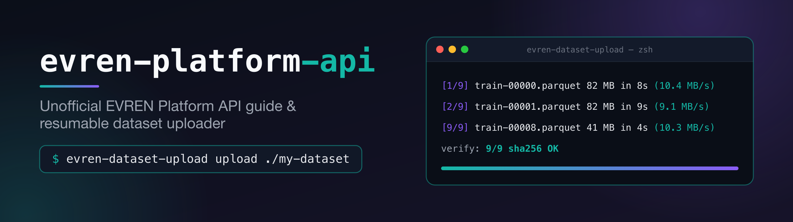

<p align="center">
  
</p>

<p align="center">
  <a href="LICENSE"></a>
  
  
  
  
  <a href="AGENTS.md"></a>
  <a href="docs/opencode.md"></a>
</p>

<p align="center">
  <code>evren</code> <code>evren-platform</code> <code>rest-api</code> <code>dataset-upload</code> <code>resumable-upload</code>
  <code>nlp-datasets</code> <code>turkish-ai</code> <code>opencode</code> <code>ai-agents</code> <code>python-stdlib</code>
</p>

**evren-platform-api, EVREN yapay zeka platformunun REST API'sinde veri seti oluşturmayı, dosyaları kaldığı yerden devam ettirilebilir biçimde yüklemeyi ve yayınlamayı gösteren; hazır bir OpenCode iş akışı da içeren, ücretsiz, açık kaynaklı ve resmi olmayan bir rehber ve araç setidir.**

*(İngilizce kanonik cümle: "evren-platform-api is a free, open-source, unofficial guide and toolkit for the EVREN AI platform's REST API that shows how to create datasets, upload files resumably and publish them, with a ready OpenCode workflow.")*

[English](README.md) | Türkçe

> **Resmi değildir.** Bu proje SSB veya EVREN platformu ile bağlantılı değildir ve onlar tarafından onaylanmamıştır. "EVREN" adı yalnızca kodun hangi API ile çalıştığını belirtmek için kullanılır. EVREN logosu, renkleri veya markası kullanılmaz. Kendi hesabınız ve platformun şartları altında hareket edersiniz; yüklenen veri setleri ve modeller platform tarafından kullanıcı sözleşmesi uyarınca eğitim için kullanılabilir, bu yüzden yüklemeden önce sözleşmeyi okuyun.

## Neden var?

EVREN'in **LLM geçidini** (gateway) zaten topluluk projeleri kapsıyor: bir OpenCode sağlayıcı yükleyicisi, komut satırı istemcileri, sohbet arayüzleri ve eğitim için bir MCP sunucusu. Henüz kimsenin yazıya dökmediği şey, veri setleri için **Platform REST API**'sidir:

- hangi API anahtarı türünün hangi uç noktayı çağırabildiği,
- web formu yalnızca görüntü ve tıbbi veri seti sunsa da API üzerinden **NLP veri seti oluşturulabildiği**,
- üç adımlı yükleme (presign, PUT, confirm), tekilleştirmenin nasıl çalıştığı ve sonucun nasıl doğrulanacağı,
- tüm bunların bir betikten veya bir yapay zeka kodlama ajanından, kaldığı yerden devam edilebilir biçimde nasıl yapılacağı.

Bu depo, bu bilgileri 2026-10-26 tarihinde canlı API üzerinde ölçüldüğü haliyle belgeler ve işi yapan küçük bir araç içerir.

## Hızlı başlangıç

Python 3.9 veya üstü gerekir. Kurulacak bir şey yoktur.

**1. Anahtar alın.** EVREN web uygulamasında Ayarlar -> API Anahtarları bölümünden bir `evren_plt_` anahtarı oluşturun (yalnızca bir kez gösterilir).

```bash
git clone https://github.com/nsozturk/evren-platform-api
cd evren-platform-api
export EVREN_PLATFORM_KEY="evren_plt_..."     # kendi anahtarınız; asla commit etmeyin
```

**2. Bir veri seti klasörü hazırlayın**: veri dosyaları, bir veri seti kartı ve bir README:

```bash
mkdir my-dataset                               # içine train.parquet, data.jsonl, ... koyun
cp examples/card.example.json my-dataset/card.json   # ad, açıklama, lisans ve etiketleri düzenleyin
$EDITOR my-dataset/README.md                   # platformda gösterilen veri seti kartı
```

**3. Veri setini oluşturun** (özel NLP; önce önizleme):

```bash
python3 tools/evren_dataset_upload.py manifest my-dataset
python3 tools/evren_dataset_upload.py create --card my-dataset/card.json --readme my-dataset/README.md --dry-run
python3 tools/evren_dataset_upload.py create --card my-dataset/card.json --readme my-dataset/README.md --visibility private
```

**4. Yükleyin.** İstediğiniz an durdurup yeniden çalıştırabilirsiniz; kaldığı yerden devam eder.

```bash
python3 tools/evren_dataset_upload.py upload my-dataset
```

**5. Doğrulayın**: her dosya sunucuda ve SHA-256 değeri eşleşiyor mu:

```bash
python3 tools/evren_dataset_upload.py verify my-dataset
# verify my-dataset: server 9 / manifest 9 | missing [] | extra [] | not ready [] -> OK
```

Yükleyici zaman damgalı ilerleme satırları yazar, 5xx, 429 ve ağ hatalarında geri çekilmeli (backoff) yeniden dener, dosyaları belleğe okumadan diskten akıtır ve bir günlük (journal) tutar; böylece yeniden çalıştırma tamamlanmış dosyaları atlar. Varsayılan dosyalar veri seti klasörünün içindedir (`.evren_dataset.json`, `.evren_upload_journal.jsonl`, `.evren_upload.log`). Çıkış kodları: `0` başarılı, `1` işlem başarısız, `2` kullanım veya yapılandırma hatası.

## Hangi API anahtarına ihtiyacım var?

| Anahtar | Önek | Sunucu | Başlık | Ne için |
|---|---|---|---|---|
| Tam platform anahtarı | `evren_plt_` | `https://api.ssyz.org.tr/api/v1` | `X-API-Key` | Veri setleri, modeller, faturalama, katalog |
| Yalnızca model anahtarı | `evren_mdl_` | aynı | `X-API-Key` | Yalnızca modeller ve çıkarım (veri seti çağrıları 403 döner) |
| LLM geçidi anahtarı | `evren_llm_` | `https://evren-llmapi.ssyz.org.tr/v1` | `Authorization: Bearer` | Sohbet, embedding, OCR, ... (Platform API'si için değil) |

Veri seti işleri için `evren_plt_` gerekir. Ayrıntılar ve ölçülen yetki matrisi: [docs/api/keys.md](docs/api/keys.md).

## API başvurusu

| Sayfa | İçerik |
|---|---|
| [docs/api/keys.md](docs/api/keys.md) | Sunucular, başlıklar, anahtar türleri ve yetkileri, yanıt zarfı |
| [docs/api/datasets.md](docs/api/datasets.md) | Oluşturma, listeleme, silme, öğeler, katalog araması, sürümler, dışa aktarma |
| [docs/api/upload.md](docs/api/upload.md) | curl ve Python ile presign / PUT / confirm, tekilleştirme, doğrulama, parçalama, `.npy` -> Parquet |
| [docs/api/llm-gateway.md](docs/api/llm-gateway.md) | LLM geçidine kısa giriş ve şartların kabul akışı |
| [docs/api/errors.md](docs/api/errors.md) | Hata biçimi, 401/403 durumları, yeniden deneme önerileri, çıkış kodları |
| [docs/opencode.md](docs/opencode.md) | OpenCode sağlayıcı bloğu ve deponun OpenCode komutu |

(API belgeleri İngilizcedir.)

## OpenCode ile kullanım

[OpenCode](https://opencode.ai) desteklenen ilk ajan ortamıdır. Depoda bir [`AGENTS.md`](AGENTS.md) sözleşmesi ve özel bir komut vardır; böylece bir ajan sizin için bir klasörü yayınlayabilir:

```bash
export EVREN_PLATFORM_KEY="evren_plt_..."
opencode
# OpenCode içinde:
/evren-publish-dataset ./my-dataset
```

Komut manifest oluşturur, **özel** bir NLP veri seti yaratır, yükler, doğrular, rapor verir ve herkese açık yapmadan önce sorar. EVREN'in barındırdığı modelleri OpenCode modeli olarak kullanmak için [`opencode.example.json`](opencode.example.json) içindeki sağlayıcı bloğunu ekleyin (anahtar `EVREN_LLM_API_KEY` ortam değişkeninden okunur); bkz. [docs/opencode.md](docs/opencode.md). Bu yönergeleri herhangi bir asistana genel olarak vermek için [`GLOBAL_AGENT_RULE.md`](GLOBAL_AGENT_RULE.md) içeriğini asistanın genel talimatlarına yapıştırın.

## Platform kredileri

Platformun fiyatlandırma sayfasından (2026-10-26; güncel değerler için sayfaya bakın):

| Kalem | Kredi (CR) |
|---|---|
| Başlangıç bakiyesi | 1000 |
| Günlük giriş | +10 |
| Bir veri seti yayınlamak | +5 (günde en fazla 3) |
| 100 / 500 / 1K / 5K / 10K öğe eşikleri | +2 / +5 / +15 / +25 / +40 |
| Günlük kazanç tavanı | 100 |
| GPU eğitimi, 1x H200 | saatte 10 |

Eşikler satırları değil dosyaları sayar; yayınlanmamış veri setleri sayılmaz; veri setlerinin en az %80 çeşitliliğe sahip olması gerekir. LLM geçidi ücretsizdir ve kredilerden bağımsızdır (günde 15M token, 5 dakikada 2,5M token, 32 eşzamanlı istek). Bakiyenizi `GET /billing/balance` döndürür.

## Sık sorulan sorular

### EVREN'e metin veya tablo verisi yükleyebilir miyim?

Evet. Kabul edilen biçimler arasında Parquet, Arrow, Feather, SQLite, CSV, TSV, JSON, JSONL, NDJSON, TXT, Markdown ve PDF ile görüntü, ses ve video bulunur. Veri setini `"modality": "NLP"` ile oluşturun ve dosyaları [docs/api/upload.md](docs/api/upload.md) içindeki üç adımlı akışla yükleyin.

### Web formu neden NLP seçeneği sunmuyor?

Web "yeni veri seti" formu yalnızca görüntü ve tıbbi veri setlerini etkinleştirir, ancak API `NLP` değerini kabul eder (2026-10-26'da doğrulandı). Bu proje platformun niyetini bilmez; API üzerinden NLP'yi bugün çalışan ama garanti edilmeyen bir davranış olarak değerlendirin.

### Hangi API anahtarına ihtiyacım var?

Veri setleriyle ilgili her şey için `X-API-Key` başlığında gönderilen bir `evren_plt_` anahtarı. `evren_mdl_` anahtarları modeller ve çıkarımla sınırlıdır; `evren_llm_` anahtarları yalnızca LLM geçidinde çalışır. Yukarıdaki [tabloya](#hangi-api-anahtarına-ihtiyacım-var) bakın.

### `.npy` destekleniyor mu?

Hayır. Platformun uzantı listesinde `.npy` yoktur. Dizileri Parquet'e çevirin; [docs/api/upload.md](docs/api/upload.md#converting-npy-to-parquet) içinde parça parça çalışan bir `pyarrow` örneği var.

### Bir dosya en fazla ne kadar büyük olabilir?

0,7 KB, 105 MB ve 316 MB'lık dosyaların hepsi başarıyla yüklendi; 316 MB'a kadar bir sınıra takılınmadı. Araç 280 MB üstünde uyarır ve test edilen aralıkta kalmak için parçalamayı önerir.

### Yükleme yarıda kesilirse ne olur?

Aynı komutu yeniden çalıştırın. Tamamlanan dosyalar günlükten atlanır, sunucu da SHA-256 ile tekilleştirir ve `verify` eksik bir şey olup olmadığını söyler.

### Yayınlamak kredi kazandırır mı?

Evet, [Platform kredileri](#platform-kredileri) bölümündeki sınırlar içinde: yayınlanan her veri seti için +5 CR (günde en fazla üç), ayrıca öğe eşikleri; günlük kazanç tavanı 100 CR.

### Bu resmi bir proje mi?

Hayır. SSB veya EVREN platformu ile bağlantısı olmayan, bağımsız bir topluluk projesidir. En üstteki nota bakın.

### Bir yapay zeka ajanı bunu güvenle çalıştırabilir mi?

[`AGENTS.md`](AGENTS.md) tam olarak bunun için var: anahtarlar ortam değişkeninde kalır, veri setleri özel oluşturulur, şartlar sizin adınıza asla kabul edilmez ve siz istemeden hiçbir şey herkese açık yapılmaz.

## İlgili projeler ve alternatifler

Bu topluluk projeleri kolaylık için adıyla bağlanmıştır; onay anlamına gelmez ve bu depo onları tekrarlamaz. Çoğu, burada belgelenen veri seti API'sinden farklı bir yüzey olan LLM geçidini kapsar.

| Proje | Ne olduğu |
|---|---|
| [bykemalh/evren-llm-opencode](https://github.com/bykemalh/evren-llm-opencode) | OpenCode LLM sağlayıcı yükleyicisi |
| [emuzinun/evren-mcp](https://github.com/emuzinun/evren-mcp) | Claude Code'dan maliyet onaylı eğitim için MCP sunucusu |
| [speker/evren-sdk](https://github.com/speker/evren-sdk) | Python SDK: görüntü çıkarımı ve görsel yükleme |
| [necmettincimen/evren-cli](https://github.com/necmettincimen/evren-cli) | LLM geçidi üzerinde terminal kodlama asistanı |
| [zakcali/evren-chat](https://github.com/zakcali/evren-chat) | Gradio sohbet istemcisi |
| [erdalnacitunc-create/evren-desktop](https://github.com/erdalnacitunc-create/evren-desktop) | Windows masaüstü istemcisi |
| [drdoof2019/EvrenLLM-Kullanim](https://github.com/drdoof2019/EvrenLLM-Kullanim) | LLM geçidi kullanım notları (Türkçe) |

Bu depo; metin ve tablo veri setleri, kesintiye dayanıklı aktarımlar ve yapay zeka ajanlarıyla kullanım boşluğunu doldurur.

## Diğer CLI'ler: planlandı

Önce OpenCode desteklenir; Claude Code, Codex, Gemini CLI ve Cursor için hazır kurulumlar planlanmaktadır.

## Lisans

[MIT](LICENSE). Katkılar issue ve pull request ile memnuniyetle karşılanır; lütfen aracı yalnızca standart kütüphaneyle ve testleri çevrimdışı tutun.
